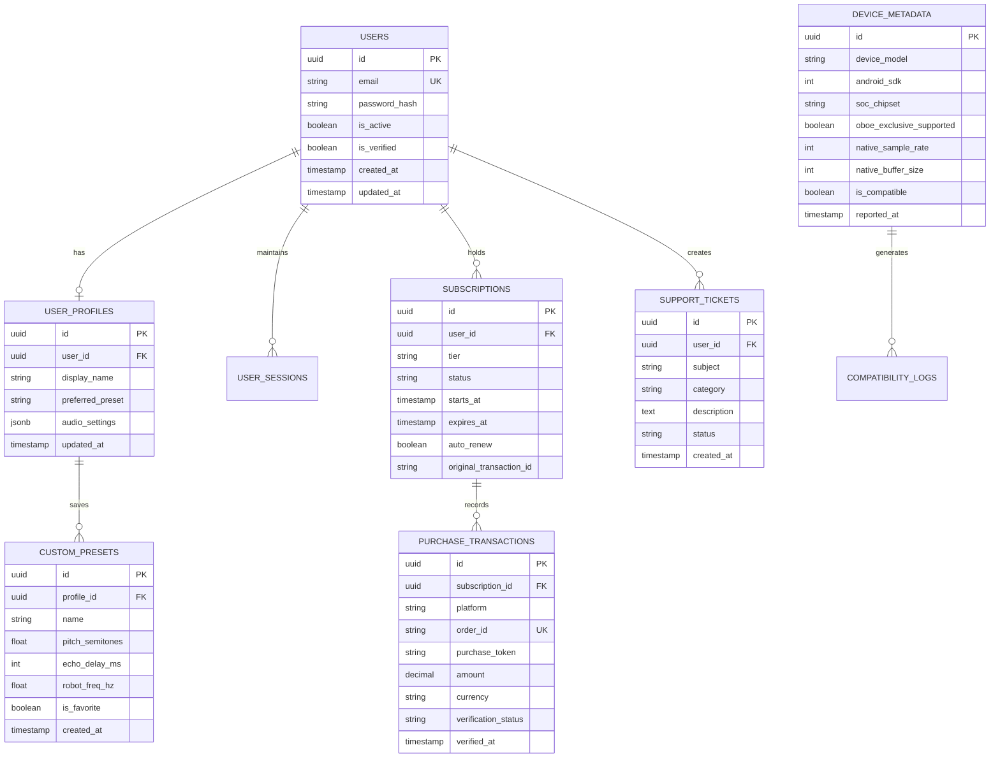

# Database Architecture & Migration Specification

**Document ID:** DOC-DB-001  
**Engine:** PostgreSQL 16+ on Ubuntu 24.04 LTS (AWS EC2)  
**ORM:** Django ORM with Versioned Schema Migrations  

---

## 1. Database Architecture & Hardening

### 1.1 Localhost Isolation
The database runs on the same AWS EC2 instance as the Django application for Phase 1–6 deployment.
- **Listen Address:** Strict localhost binding in `/etc/postgresql/16/main/postgresql.conf`:
  ```ini
  listen_addresses = '127.0.0.1, ::1'
  port = 5432
  max_connections = 100
  shared_buffers = 256MB
  work_mem = 4MB
  maintenance_work_mem = 64MB
  wal_level = replica
  ```
- **Firewall & Security Group:** Port 5432 is **never** opened in AWS Security Groups. It is inaccessible from the public internet.
- **Client Authentication:** Configured in `pg_hba.conf`:
  ```ini
  # TYPE  DATABASE        USER            ADDRESS                 METHOD
  local   all             postgres                                peer
  local   whatsapp_voice  wv_app_user                             scram-sha-256
  host    whatsapp_voice  wv_app_user     127.0.0.1/32            scram-sha-256
  host    whatsapp_voice  wv_app_user     ::1/128                 scram-sha-256
  ```

---

## 2. Relational Schema & Entity-Relationship Design



---

## 3. Indexing & Optimization Strategy

1. **`users(email)`:** Unique B-tree index for O(1) login lookups.
2. **`subscriptions(user_id, status, expires_at)`:** Composite index for fast entitlement queries in the request-response pipeline.
3. **`purchase_transactions(order_id)`:** Unique index to prevent replay/duplicate token injection attacks.
4. **`custom_presets(profile_id, is_favorite)`:** Filtered index for user preset retrieval.
5. **Foreign Key Indexes:** Explicit indexes on all FK fields to prevent full table scans on cascading updates or joins.

---

## 4. Automated Backup & Encryption Strategy

- **Schedule:** Nightly automated backup executed via system cron (`0 3 * * *`).
- **Mechanism:** `pg_dump` compressed with `gzip`, encrypted with `gpg` AES-256 using an offline symmetric key.
- **Retention Policy:**
  - Daily backups: Retained for 7 days.
  - Weekly backups: Retained for 4 weeks.
  - Monthly backups: Retained for 12 months.
- **Zero Raw Audio Storage Rule:** The database stores strictly administrative, authentication, and preset metadata. **Raw PCM audio, speech recordings, or call contents are NEVER stored.**

---

## 5. Future Migration Path to Amazon RDS

When application traffic exceeds the compute or storage capacity of a single EC2 instance:
1. **Provision Amazon RDS for PostgreSQL:** Deploy a Multi-AZ RDS instance in the same AWS VPC and Availability Zone.
2. **Security Group Binding:** Authorize inbound traffic on port 5432 exclusively from the EC2 application security group.
3. **Data Replication:**
   ```bash
   # Dump local database
   pg_dump -h 127.0.0.1 -U wv_app_user -d whatsapp_voice --no-owner --clean | gzip > /var/backups/migration.sql.gz
   
   # Restore to Amazon RDS
   gunzip -c /var/backups/migration.sql.gz | psql -h wv-prod.xxxxxx.us-east-1.rds.amazonaws.com -U wv_app_user -d whatsapp_voice
   ```
4. **Zero-Code Application Cutover:** Update `DATABASE_URL` or `POSTGRES_HOST` in `/etc/whatsapp-voice/environment` to point to the RDS endpoint and restart Gunicorn via `systemctl restart gunicorn`.
